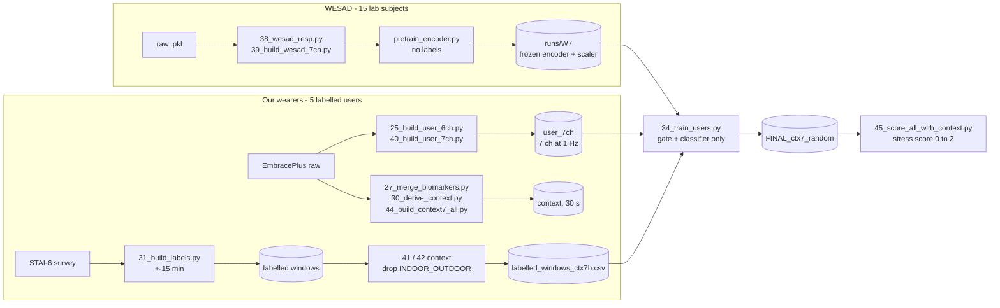

# ContextGate: Physiological Signal Understanding and Stress Level Detection

**B.Tech Project (BTP)** · Akshat Priyadarshi (23CS30003) · CSE Dual Degree, IIT Kharagpur
**Supervisor:** Dr. Bivas Mitra

A stress model for a wrist wearable. A frozen encoder, pretrained **without labels on WESAD**, reads 60 s of
7 wrist channels. A learned **gate** blends that signal summary with 7 **context** columns (hour, posture,
activity, body position, sleep, ...). A small classifier turns the result into Low / Medium / High stress and a
0 to 2 stress score. Labels for our five wearers come from STAI-6 survey answers.

## How it fits together



The complete file-by-file flowcharts (WESAD and users) are in **[docs/latex/ContextGate_Pipeline.pdf](docs/latex/ContextGate_Pipeline.pdf)**
(source: `docs/latex/ContextGate_Pipeline.tex`, compile with pdfLaTeX).

## Repository map

| Folder | What is in it |
|---|---|
| `00_setup_and_configs/` | project layout script and YAML configs (`w7.yaml` is the final model) |
| `01_wesad_preprocessing_and_audit/` | WESAD preprocessing, 7-channel build, audit and leakage checks |
| `02_wearer_data_pipeline/` | raw EmbracePlus files to 7 channels at 1 Hz, derived context signals |
| `03_labels_and_context/` | STAI-6 answers to labels, the 7 context columns |
| `04_model_code_and_training/` | model (encoder, gate, classifier), SSL pretraining, `34_train_users.py` |
| `05_evaluation/` | score every window, context ablation, actual vs detected |
| `06_trained_models/` | trained encoder (W7) and final classifier |
| `07_demo_and_inference/` | demo sessions, laptop and Jetson inference, dashboards, power measurement |
| `08_exploration_chronos/` | Chronos-token experiments (explored, not in the final model) |
| `09_results_and_labels/` | label files, comparison tables and figures, WESAD results, decisions |
| `docs/` | `CODE_GUIDE.md` (architecture and maths), `FILE_GUIDE.md` (every script), `latex/` |

## Quick start

```bash
pip install -r requirements.txt
# trained weights are included, so scoring needs no training. The demo sessions are
# participant data and are not in the repo: put your own sessions in
# 07_demo_and_inference/demo_sessions_pack/ (same layout as README_device_demo.md), then:
cd 07_demo_and_inference && bash run_all.sh
```

To rebuild from scratch, run the scripts in folder order (`01` to `05`); numbers in the filenames give the order.
See `docs/CODE_GUIDE.md` for the commands and the architecture.

## Data

Raw WESAD and the wearers' EmbracePlus recordings are **not** in this repository. WESAD is public
(Schmidt et al., ICMI 2018). The wearers' signals and survey answers are personal data and are excluded by
`.gitignore`. The download notebooks have their credentials removed; set your own keys as environment variables.

## Results, stated plainly

- Saved model: balanced accuracy **0.841** on a random window split (5 seeds). This measures recall of near-identical
  windows, **not** prediction: on answers or people it has not seen, it does not reliably beat guessing.
- One survey answer labels about 60 overlapping windows, so the effective sample is 88 answers, not 5,119 windows.
- WESAD audit: 0.935 random split, 0.800 with overlap handled, 0.567 deep model on unseen subjects; Task as context
  alone scores 1.000 (leakage), so WESAD context is not used in the final model.

## Acknowledgements

Built on the AdaStress codebase (see `04_model_code_and_training/adastress/LICENSE`). Dataset: WESAD.
